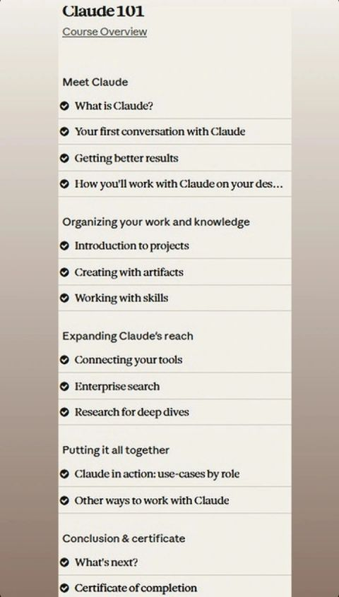

# Claude 101 — Course Notes (Arabic)

My full write-up after completing **Claude 101** by **Anthropic** — originally shared on [LinkedIn](https://www.linkedin.com/in/yassmeena-osama-2699693a1/recent-activity/all/), now archived here.

خلصت كورس Claude 101 من Anthropic، وحبيت أشارك اللي اتعلمته، لأن Claude بقى أكبر بكتير من شات بتسأله وبيجاوبك.

**Anthropic طلّعت 4 فئات من النماذج:**
- **Haiku**: الأسرع، للمهام السريعة.
- **Sonnet**: متوازن، ويكفي أغلب الاستخدامات.
- **Opus**: للمهام المعقدة.
- **Fable**: الأقوى حاليًا.

**وبقى حواليه منتجات كاملة:**
- **Claude Code**: بتسلّمه مهام البرمجة وهو يشتغل عليها.
- **Claude Design**: بتوصف اللي عايزه، يطلعلك تصميم أو عرض أو prototype.
- **Claude Security**: بيفحص الكود ويدوّر على الثغرات ويقترح إصلاحها.
- **Cowork**: للشغل اللي فيه خطوات كتير، وبقى جزء من Claude نفسه.

**أهم اللي أخدته من الكورس:**

1. **طريقة الطلب**: كل ما وضّحت السياق والهدف وإديته مثال، النتيجة بتبقى أحسن.
2. **Projects**: بتحط ملفاتك وتعليماتك في مكان واحد، فمش بتعيد الشرح كل مرة، وده بيوفر توكنز.
3. **Artifacts**: بتطلّع الفكرة صفحة أو أداة أو مستند تقدر تعدّل فيه وتشاركه.
4. **Skills**: تعليمات جاهزة بتخلي Claude يشتغل بطريقتك كل مرة.
5. **الربط بأدواتك والبحث المعمّق**: يوصل لملفاتك وتطبيقاتك، ويعمل بحث بمصادر في المواضيع الكبيرة.

الكورس مجاني وبسيط، ولو بتستخدم Claude من غير ما تكون مستغله بشكل صحيح فانت فايتك كتير

`#Claude` `#Anthropic` `#Claude101`

---

## Post Images

| | |
|---|---|
|  |  |

---

*Notes by [Yassmeena Osama](https://github.com/Yasmeena18) — CS student exploring practical AI.*
